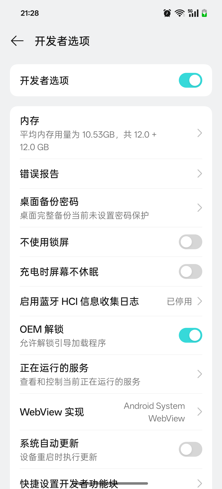
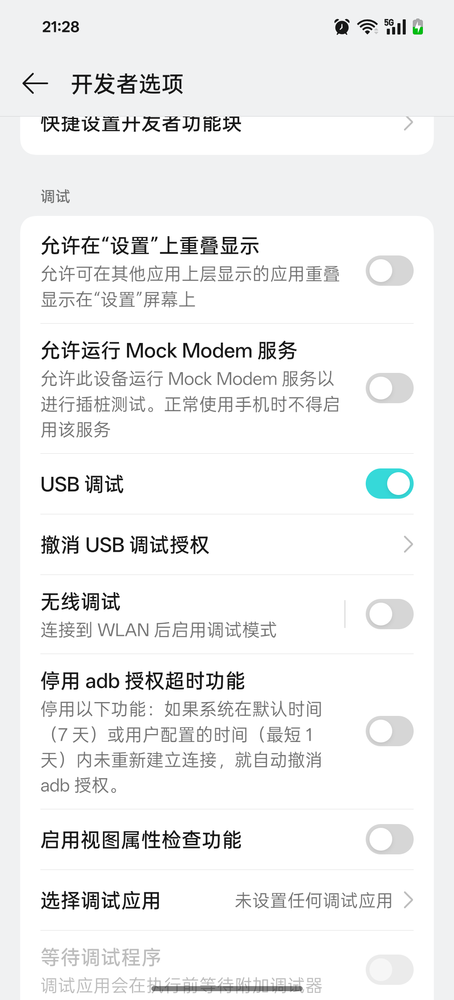

# Android Ad Optimizer Skill

一个可被 Codex、Claude Code、Cursor 等 Agent 调用的 Android 减少广告与打扰 Skill。

它通过电脑上的 `adb` 做只读检查、备份和按通知渠道的可恢复调整，重点保留：

- 聊天、邮件、订单物流、支付、账户安全
- 日历、天气预警、系统更新
- AI 回复和任务完成提醒

默认不做：

- 清除应用数据
- 修改代理或网络
- 卸载应用
- 一刀切关闭整个应用通知
- 未经确认停用系统包

## 使用

把 `skill/android-ad-optimizer` 安装到 Agent 的 skills 目录，然后使用：

```text
请使用 android-ad-optimizer，检查连接的安卓设备，先给出备份和修改计划。
```

## 完整流程

这个 Skill 不假设 ADB 已经配置好。首次使用时，按以下顺序操作：

1. 电脑安装官方 Android SDK Platform-Tools，并确保 `adb` 可在终端运行。
2. 手机解锁后接入 USB 数据线。
3. 手机打开 `设置 > 关于手机`，连续点击 `版本号/Build number` 开启开发者选项。
4. 在 `系统` 或 `其他设置 > 开发者选项` 中开启 `USB 调试`。
5. 看到“允许 USB 调试？”时核对电脑指纹；只对信任的电脑勾选“始终允许”，不要接受无关的文件访问、安装或投屏提示。
6. Agent 运行 `devices`，只有状态为 `device` 且目标唯一时才继续；`unauthorized`、`offline`、无设备或多设备都会暂停并提示处理。
7. Agent 先只读检查，再备份并输出精确计划；用户确认计划后才执行可恢复修改。
8. 修改后逐项复核，最后用户手动关闭 USB 调试并拔线。

各品牌菜单名称可能不同，故障处理见
`skill/android-ad-optimizer/references/adb-onboarding.md`。

### 真实设备截图：一加 Ace 5 / ColorOS 15

截图只用于说明入口位置；其他品牌和系统版本可能有不同的菜单名称。截图中的 USB 调试已开启，使用完成后应按流程手动关闭。

开发者选项入口：



USB 调试入口：



脚本只依赖 Python 标准库和 Android SDK Platform Tools：

```powershell
python .\skill\android-ad-optimizer\scripts\android_ad_optimizer.py devices
python .\skill\android-ad-optimizer\scripts\android_ad_optimizer.py inspect
python .\skill\android-ad-optimizer\scripts\android_ad_optimizer.py backup
python .\skill\android-ad-optimizer\scripts\android_ad_optimizer.py plan
python .\skill\android-ad-optimizer\scripts\android_ad_optimizer.py apply --yes
python .\skill\android-ad-optimizer\scripts\android_ad_optimizer.py restore .\backups\<备份目录> --yes
```

`apply --yes` 只处理名称明确属于营销、推荐、热门、福利、活动、优惠或内容营销的通知渠道；聊天、订单、物流、支付、安全、天气、更新等保护词会跳过。

这是“减少广告和打扰”，不是去除所有广告。应用内信息流广告、开屏广告和账号内推荐仍可能存在。

## 目录

```text
skill/android-ad-optimizer/
  SKILL.md
  references/
    safety.md
  scripts/
    android_ad_optimizer.py
tests/
  test_android_ad_optimizer.py
```

许可证：MIT
